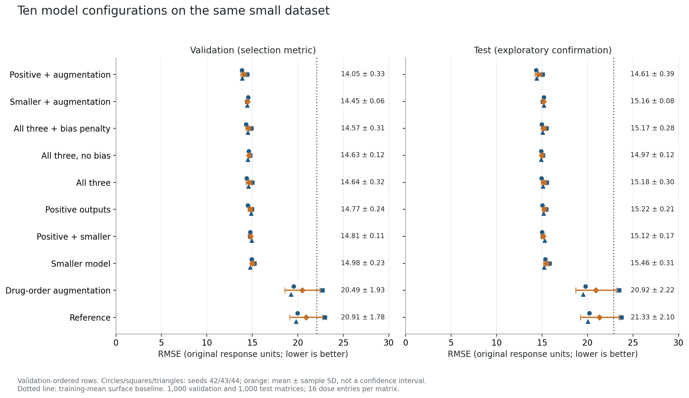
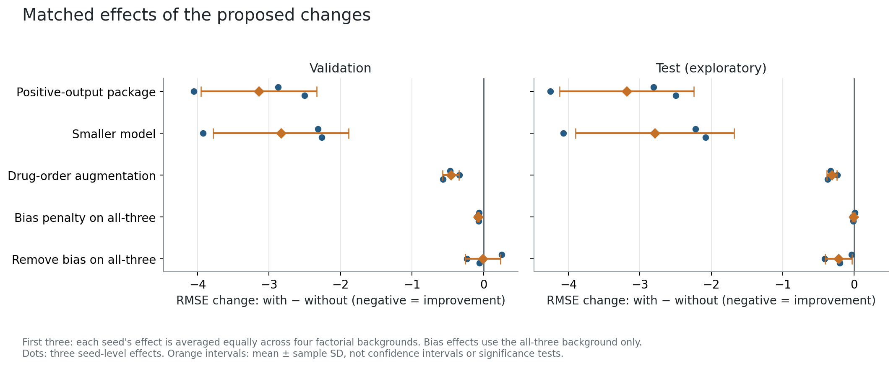
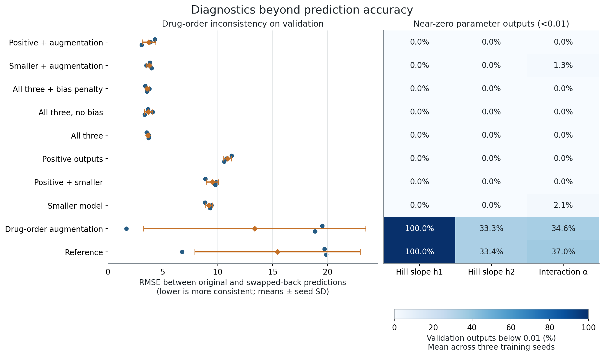
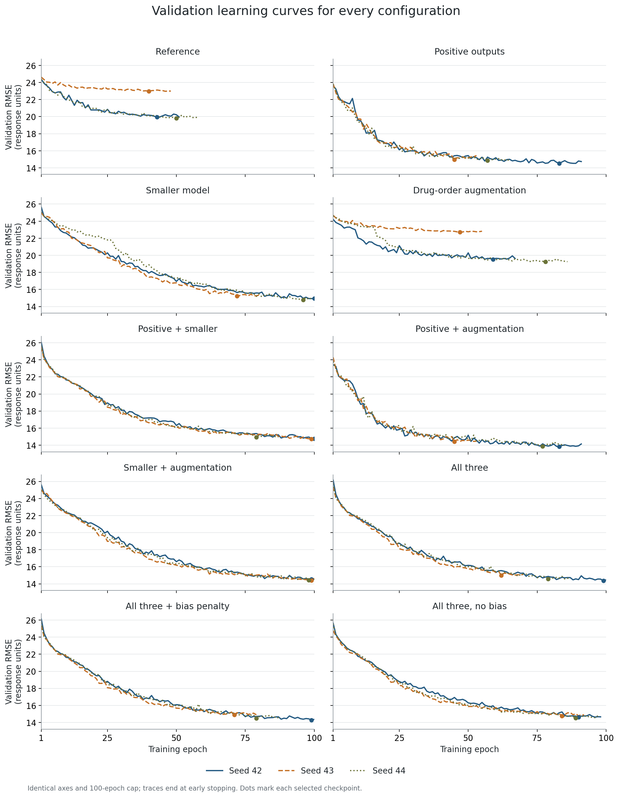
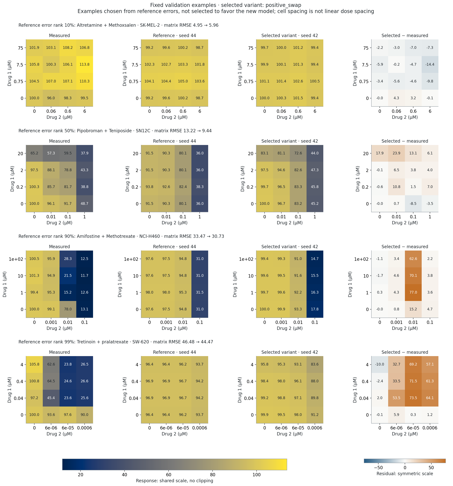

# DeepSynBa small-data enhancement comparison

Ten configurations × three seeds = **30 completed runs** on the same 5,000-example dataset. The configuration selected by mean validation RMSE is **Positive + augmentation** (`positive_swap`). Its test RMSE is **14.605 ± 0.390**, versus **21.327 ± 2.095** for the reference (+31.5% relative RMSE reduction). All ± values are sample SD across three training seeds, not confidence intervals.

## Accuracy and model size

Rows are ordered by validation performance, not by test results. Full metrics pool 16,000 entries from 1,000 matrices per split; combination-only metrics pool the 9,000 nonzero-dose interior entries.

| Configuration | Parameters (M) | Validation RMSE | Test RMSE | Test Pearson | Test Spearman | Combination-only RMSE |
| --- | ---: | ---: | ---: | ---: | ---: | ---: |
| Positive + augmentation | 40.94 | 14.048 ± 0.329 | 14.605 ± 0.390 | 0.834 ± 0.010 | 0.638 ± 0.010 | 17.497 ± 0.407 |
| Smaller + augmentation | 3.50 | 14.454 ± 0.064 | 15.161 ± 0.082 | 0.818 ± 0.001 | 0.628 ± 0.003 | 18.105 ± 0.101 |
| All three + bias penalty | 3.50 | 14.565 ± 0.307 | 15.174 ± 0.279 | 0.816 ± 0.008 | 0.625 ± 0.004 | 18.086 ± 0.301 |
| All three, no bias | 2.90 | 14.629 ± 0.121 | 14.966 ± 0.118 | 0.820 ± 0.004 | 0.623 ± 0.005 | 17.842 ± 0.143 |
| All three | 3.50 | 14.640 ± 0.321 | 15.185 ± 0.297 | 0.816 ± 0.009 | 0.626 ± 0.006 | 18.089 ± 0.309 |
| Positive outputs | 40.94 | 14.770 ± 0.240 | 15.223 ± 0.206 | 0.820 ± 0.008 | 0.625 ± 0.006 | 18.177 ± 0.209 |
| Positive + smaller | 3.50 | 14.811 ± 0.113 | 15.119 ± 0.169 | 0.819 ± 0.004 | 0.620 ± 0.003 | 18.013 ± 0.172 |
| Smaller model | 3.50 | 14.978 ± 0.230 | 15.459 ± 0.306 | 0.811 ± 0.009 | 0.622 ± 0.005 | 18.384 ± 0.319 |
| Drug-order augmentation | 40.94 | 20.495 ± 1.929 | 20.925 ± 2.215 | 0.588 ± 0.130 | 0.455 ± 0.081 | 23.233 ± 2.091 |
| Reference | 40.94 | 20.910 ± 1.784 | 21.327 ± 2.095 | 0.570 ± 0.130 | 0.439 ± 0.083 | 23.570 ± 1.872 |

The training-mean surface baseline has validation RMSE 22.087 and test RMSE 22.885.

**Accuracy choice:** Positive + augmentation, selected using mean validation error. **Compact alternative:** Smaller + augmentation, the lowest-validation-error configuration among models under 4 million parameters. It uses 3.50 million parameters (91.5% fewer than the reference), with validation RMSE 14.454 and test RMSE 15.161 ± 0.082. The compact alternative is a descriptive size/accuracy tradeoff, not a second confirmatory winner.

## Which changes helped?

These matched contrasts compare the same seed and other factor settings. The first three average each seed's effect over four matched factorial backgrounds. The bias comparisons are conditional on the all-three variant only. Negative RMSE changes indicate improvement. Three seeds are not enough to establish statistical significance.

| Change | Validation RMSE change | Test RMSE change | Backgrounds |
| --- | ---: | ---: | ---: |
| Positive-output package | -3.142 ± 0.809 | -3.185 ± 0.938 | 4 |
| Smaller model | -2.835 ± 0.946 | -2.789 ± 1.110 | 4 |
| Drug-order augmentation | -0.458 ± 0.114 | -0.313 ± 0.070 | 4 |
| Bias penalty on all-three | -0.075 ± 0.015 | -0.011 ± 0.020 | 1 |
| Remove bias on all-three | -0.011 ± 0.248 | -0.218 ± 0.189 | 1 |

Main effects are averages, not promises for every combination. The individual matched differences are retained in `matched_differences.csv`; interactions and differing convergence can affect them.

## Parameter and drug-order diagnostics

The positive-output package is Softplus + 0.0001 for h1, h2 and alpha, together with near-one initialization (final weights scaled by 0.01). Activation and initialization were changed together; this experiment does not separate their effects. Exact positivity alone is not sufficient: the table also checks outputs below 0.01.

| Configuration | Swap inconsistency RMSE | h1 <0.01 | h2 <0.01 | alpha <0.01 | Bias RMS |
| --- | ---: | ---: | ---: | ---: | ---: |
| Positive + augmentation | 3.734 ± 0.624 | 0.0% | 0.0% | 0.0% | 3.606 |
| Smaller + augmentation | 3.761 ± 0.241 | 0.0% | 0.0% | 1.3% | 3.308 |
| All three + bias penalty | 3.566 ± 0.187 | 0.0% | 0.0% | 0.0% | 2.435 |
| All three, no bias | 3.698 ± 0.369 | 0.0% | 0.0% | 0.0% | 0.000 |
| All three | 3.647 ± 0.102 | 0.0% | 0.0% | 0.0% | 2.911 |
| Positive outputs | 10.882 ± 0.353 | 0.0% | 0.0% | 0.0% | 4.066 |
| Positive + smaller | 9.495 ± 0.555 | 0.0% | 0.0% | 0.0% | 3.142 |
| Smaller model | 9.185 ± 0.303 | 0.0% | 0.0% | 2.1% | 3.381 |
| Drug-order augmentation | 13.357 ± 10.110 | 100.0% | 33.3% | 34.6% | 4.218 |
| Reference | 15.441 ± 7.534 | 100.0% | 33.4% | 37.0% | 4.574 |

All diagnostics in this table use validation data. Swap inconsistency compares f(A,B) with the transposed f(B,A), with both dose axes swapped. Random augmentation encourages consistency but does not enforce exact symmetry; inference predictions are not averaged. Bias RMS measures the magnitude of the additive bias component in response units, not its causal contribution to accuracy.

Training logs also retain the mean final-layer gradient norm and fraction of zero-gradient batches for each positive parameter at every epoch, before clipping. The unused sigma output was left unchanged and is excluded from these diagnostics.

## Convergence and computation

| Configuration | Epochs run (42 / 43 / 44) | Best epochs | Mean training seconds | Mean peak allocated GPU MB |
| --- | --- | --- | ---: | ---: |
| Positive + augmentation | 91 / 53 / 85 | 83 / 45 / 77 | 87.5 | 798 |
| Smaller + augmentation | 100 / 100 / 100 | 99 / 99 / 98 | 165.3 | 129 |
| All three + bias penalty | 100 / 79 / 87 | 99 / 71 / 79 | 153.5 | 129 |
| All three, no bias | 98 / 92 / 97 | 90 / 84 / 89 | 145.9 | 118 |
| All three | 100 / 70 / 87 | 99 / 62 / 79 | 144.7 | 129 |
| Positive outputs | 91 / 53 / 65 | 83 / 45 / 57 | 84.9 | 798 |
| Positive + smaller | 100 / 100 / 87 | 100 / 99 / 79 | 74.9 | 129 |
| Smaller model | 100 / 80 / 100 | 100 / 72 / 96 | 68.8 | 129 |
| Drug-order augmentation | 67 / 55 / 86 | 59 / 47 / 78 | 78.8 | 798 |
| Reference | 51 / 48 / 58 | 43 / 40 / 50 | 97.5 | 798 |

Total measured training time: 55.1 minutes. Timings include per-epoch validation and checkpoint writing, but exclude final diagnostic/test evaluation and plotting. GPU allocation is PyTorch's peak allocation, not total device usage. Timing is descriptive on this laptop, not a controlled hardware benchmark.

## Same-example prediction comparison

Selected configuration: `positive_swap`. Illustrative checkpoint seed 42 is chosen by validation error within that configuration. The same four validation matrices used in the earlier reference diagnostic are retained: reference seed-44 error ranks 10%, 50%, 90%, and 99%. These are error-stratified diagnostics, not a random or representative sample. Inspect both improvements and failures.

Reference → selected-model matrix RMSE for the four fixed examples: 4.95 → 5.96; 13.22 → 9.44; 33.47 → 30.73; 46.48 → 44.47. The aggregate gain does not eliminate difficult failures: the high-error and extreme-error examples still have large residuals, and the initially low-error example becomes slightly worse. These examples illustrate limitations rather than estimate their population frequency.

## Protocol, limitations, and verification

- The source model files and original results were preserved. All 30 models were trained anew. The three new reference histories and validation/test predictions match the earlier reference runs numerically.
- Fixed drug-pair-disjoint split: 3,000 training / 1,000 validation / 1,000 test matrices, with the same source data and row identities. No added experiments or relabeled targets.
- Same optimizer (AdamW, learning rate 0.0001, weight decay 0.00001), 128 batch size, gradient clipping 5, 100-epoch cap, patience 8. The original linear schedule reaches half rate at epoch 30 and remains there.
- Smaller model: gene_channel 128, emb_size 512. Drug-order augmentation swaps each training example with probability 0.5, including drugs, dose axes, and target transposition; it does not double independent sample size.
- Bias regularization uses a predeclared coefficient 0.1 on mean(bias²); the no-bias variant removes both bias networks. These two conditions were tested only on the all-three model. No regularization-coefficient search was performed.
- All variants have the same epoch budget, not equal wall time. Early stopping can interact with architecture. Size changes also change the random-number allocation to weights, so matched seeds are not identical initial functions.
- Configuration ranking uses mean validation RMSE across all three seeds, not the best individual seed or test score. All selections and checkpoint hashes were frozen before any new test evaluation. Every result is reported.
- The old test results were already inspected; new test scores are exploratory comparisons on a reused test set. A fresh pair-disjoint holdout is needed before claiming confirmatory improvement. Selecting among ten configurations also risks validation overfitting.
- Standard deviations quantify initialization/training randomness on this one small subset, not dataset-sampling uncertainty. Lower predictive error or nonzero heads does not validate the learned pharmacological parameters, synergy predictions, or clinical use.
- Analysis independently recomputed RMSE, Pearson and Spearman correlations, combination-only error, symmetry error, bias magnitude, and near-zero fractions. It checked all row IDs, responses, dose arrays, frozen hashes, best epochs, and checkpoint reload equality.

## Artifacts

- [Per-seed results](per_seed_results.csv), [configuration summary](configuration_summary.csv), [machine-readable summary](summary.json).
- [Matched differences](matched_differences.csv), [factorial contrasts](factorial_contrasts.json), [fixed prediction examples](validation_examples.json).
- [Predeclared protocol](protocol.json), [validation selections frozen before tests](selection.json), [completion record](completed.json).
- Illustrative selected checkpoint (retained in the local run archive). Variant checkpoints must be loaded with `ablation_model.build_model`, not the original runner.
- Each run contains history.csv, metrics.json, test_metrics.json, best.pt, and numeric validation/test predictions including swapped-back predictions and parameter outputs. Figures are available in PNG and SVG.
