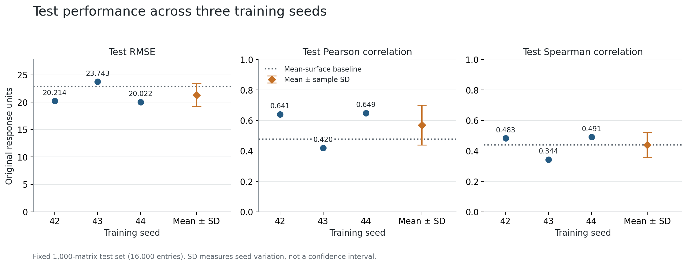
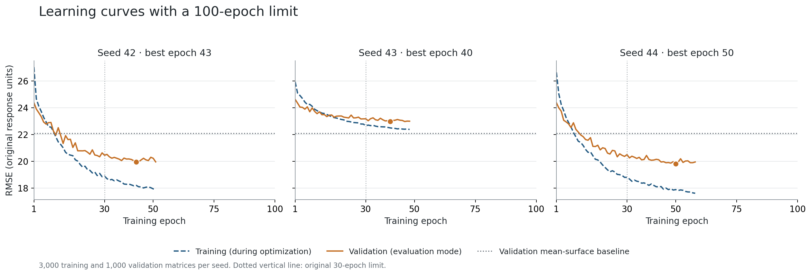
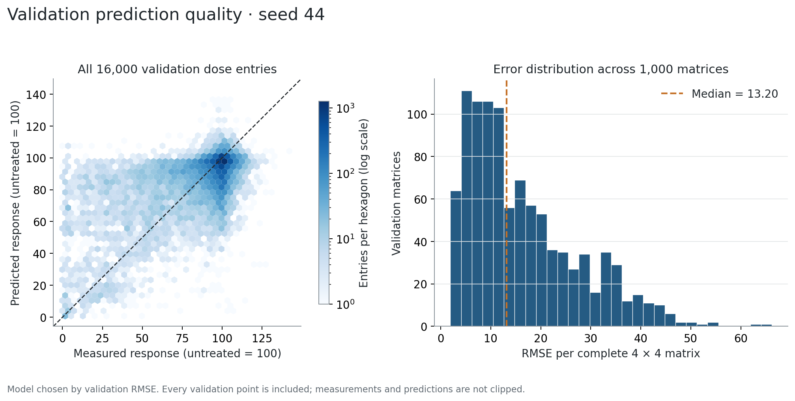
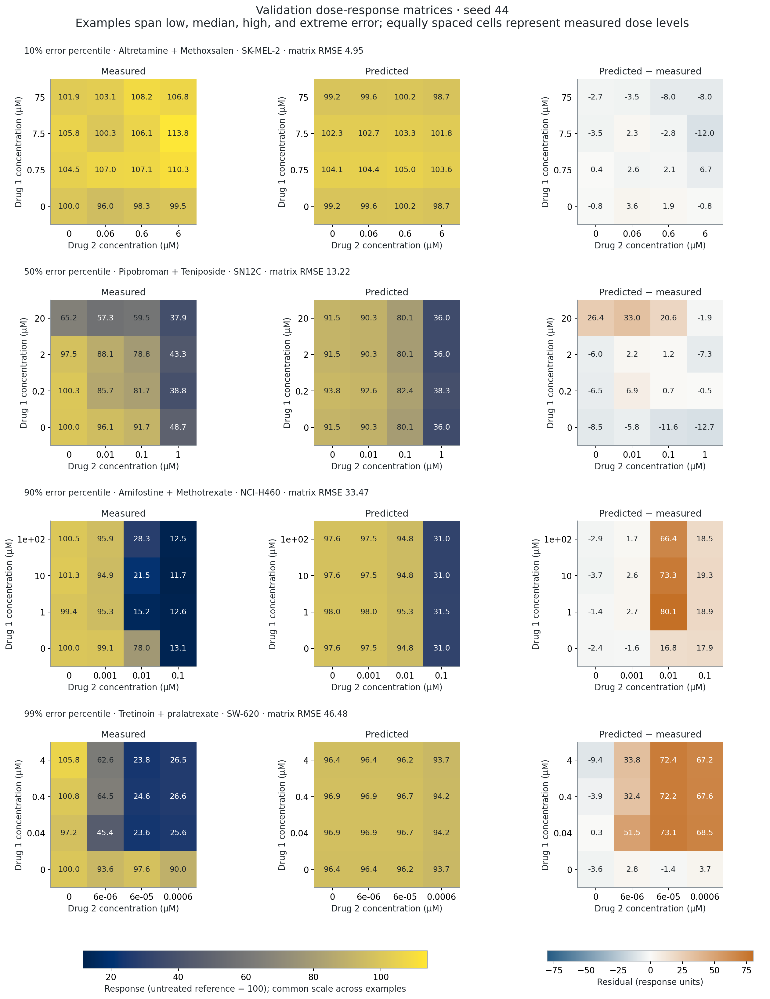

# DeepSynBa: extended small-data results

Completed three runs with a 100-epoch limit on the unchanged 5,000-example dataset. Test RMSE across training seeds is **21.327 ± 2.095** (mean ± sample SD; three seeds). The training-mean surface baseline has RMSE **22.885**. The mean RMSE is 6.8% lower than that baseline.

## Per-seed results

| Seed | Epochs run | Selected epoch | Train RMSE (eval) | Validation RMSE | Test RMSE | Pearson | Spearman | Combination-only RMSE |
| --- | ---: | ---: | ---: | ---: | ---: | ---: | ---: | ---: |
| 42 | 51 | 43 | 17.200 | 19.953 | 20.214 | 0.641 | 0.483 | 22.650 |
| 43 | 48 | 40 | 21.976 | 22.969 | 23.743 | 0.420 | 0.344 | 25.723 |
| 44 | 58 | 50 | 16.830 | 19.809 | 20.022 | 0.649 | 0.491 | 22.336 |

All-entry metrics pool 16,000 measured dose entries from 1,000 test matrices. Combination-only metrics use the 9,000 nonzero-dose interior entries. Lower RMSE is better.

Mean ± sample SD: Pearson **0.570 ± 0.130**; Spearman **0.439 ± 0.083**; combination-only RMSE **23.570 ± 1.872**.

## Longer training and generalization

For the matched seed 42, validation RMSE changed from 20.336 to 19.953. Test RMSE changed from 20.536 to 20.214 (1.6% reduction). Its first 30 training and validation epochs reproduce the prior GPU run numerically, so this comparison isolates the extra training budget for that seed.

The learning curves show online training RMSE with dropout enabled and validation RMSE in evaluation mode. Those curves are not directly equivalent estimators. The table's training RMSE is recomputed in evaluation mode at the selected checkpoint, making its train/validation gap more comparable. A gap indicates generalization error on this split; it does not alone establish that training longer causes overfitting.

## Validation prediction inspection

Seed **44** was selected for diagnostics using validation RMSE before any new test evaluation. Its test RMSE is 20.022; this is a validation-selected result, not selection of the best test score. The distribution below includes all validation examples.

The median validation matrix RMSE is 13.20; the 90th percentile is 33.48. Accuracy varies materially across combinations. In the low-error illustrated case, measured and predicted responses both stay close to the untreated reference. In the high-error and extreme-error examples, the model misses substantial measured response decreases. These observations describe the selected diagnostics, not a representative sample of all combinations.

The four matrices below were chosen by predefined 10th, 50th, 90th, and 99th percentile ranks of validation matrix RMSE. This is an error-stratified diagnostic view, not a random sample or a claim that every prediction looks like the low-error example. Measurements are not clipped. Response color scales are shared, residual scales are symmetric, and dose labels are in micromolar. Cell positions are equally spaced measured dose levels; the layout does not imply linear concentration spacing.

## Parameter diagnostics and seed sensitivity

The validation predictions were also inspected at the parameter heads, without changing the model or selecting a new configuration. The table gives the percentage of 1,000 validation examples with an exactly zero output. Only the two Hill slopes and interaction parameter are shown; the unused sigma head is excluded.

| Seed | Zero Hill slope h1 | Zero Hill slope h2 | Zero interaction alpha |
| --- | ---: | ---: | ---: |
| 42 | 100.0% | 0.0% | 5.1% |
| 43 | 100.0% | 100.0% | 100.0% |
| 44 | 100.0% | 0.1% | 5.8% |

The h1 head is zero on every validation example for seeds [42, 43, 44]. Both slopes and alpha are all zero for seeds [43]. This is a material limitation for interpreting the learned pharmacological parameters, even when aggregate prediction error improves. The diagnosis was checked using the saved trained weights, and its response predictions exactly matched the previously saved validation predictions.

In the released response equation, a zero Hill slope removes that drug's concentration dependence from the SynBa component; dose-dependent bias heads can still contribute. A zero alpha suppresses the joint interaction term. These are observed parameter-output diagnostics, not a controlled causal explanation of performance differences. ReLU activation makes zero outputs possible. Model changes to address this would constitute a separate experiment and were not made here.

## What the results support

Longer training modestly improves the matched seed-42 result, but initialization sensitivity remains large. The seed-43 run is worse than the simple mean-surface baseline. The current evidence supports a working small-data reproduction, not robust pharmacological interpretation. A useful next controlled experiment would investigate the zero-valued parameter heads (initialization and positive-output parameterization) while preserving this run as the released-code reference. Such a modified model should be labeled and compared separately using validation data.

## Protocol and limits

- Fixed source archive, subset, and released drug-pair-disjoint split: 3,000 training / 1,000 validation / 1,000 test.
- Training seeds 42, 43, and 44 were fixed before the runs. All three results are reported.
- Model widths, source model code, MSE, AdamW, and learning-rate schedule were retained. The schedule reaches half its initial rate at epoch 30 and stays there. The epoch budget is 100; early stopping patience is eight.
- Every checkpoint minimizes validation MSE within its seed. Selection hashes were frozen before evaluating tests.
- Three seeds quantify training randomness only. They do not quantify variability from resampling datasets or establish a confidence interval, significance claim, clinical validity, or replication of the paper's full-data scores.
- This experiment evaluates unseen drug pairs among known drugs and cell lines; unseen-drug/cell and O'Neil benchmarks, synergy scores, and published baseline methods were not reproduced.
- Test results from the original setup were already visible. This follow-up retained its predeclared configuration and used validation for checkpoint/model selection; it is not a new untouched benchmark dataset.

Total measured training time: 159.0 seconds, excluding process startup, installation, diagnostic evaluation, and figure generation.

## Reproducibility and verification

The analysis independently recalculated RMSE and centered-vector/rank correlations from saved numeric predictions. It checked dose arrays, original row IDs, all validation/test measurements, data checksums, frozen checkpoint hashes, minimum-validation epoch selection, and exact reproduction of validation predictions after checkpoint reload.

- [Machine-readable summary](summary.json) and [per-seed table](seed_results.csv).
- [Experiment protocol](protocol.json), [frozen model selections](selection.json), and [completion record](completed.json).
- [Validation example identities, dose grids, and numeric values](validation_examples.json).
- [Validation parameter-head diagnostics](parameter_diagnostics.json).
- Each seed directory contains its checkpoint, logs, history, environment lock, validation predictions, and final test evaluation.
- PNG and SVG versions of each figure are in `figures/`.
