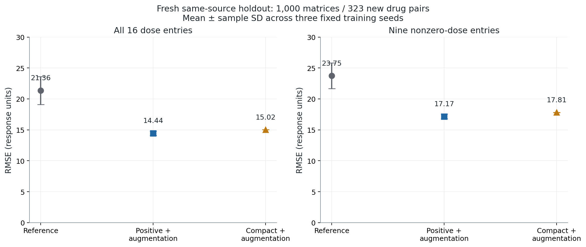
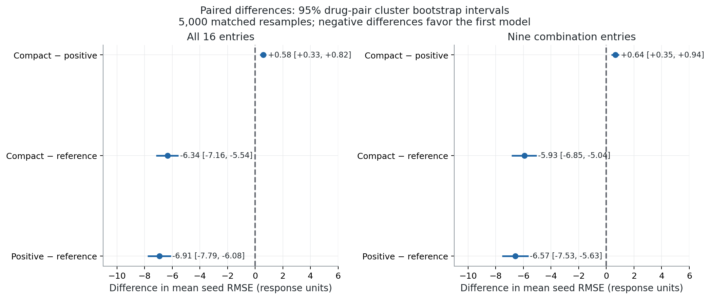
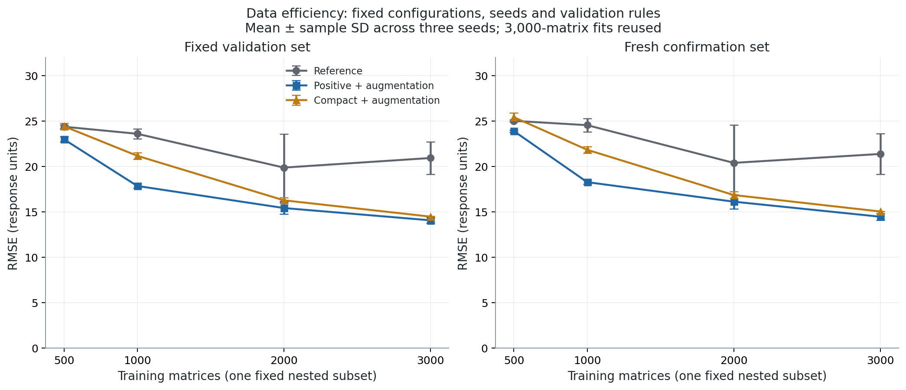

# DeepSynBa: fresh confirmation and data efficiency

The frozen positive-output-plus-augmentation model reduces mean seed RMSE by **32.4%** on 1,000 fresh matrices from 323 previously unused drug pairs. The paired difference against the reference is **-6.914** response units (95% pair-cluster percentile interval **[-7.787, -6.085]**).

## Fresh holdout

Nine existing fits (three configurations × seeds 42/43/44) were frozen by checkpoint hashes before new response access. All nine reproduced their saved validation predictions exactly on CUDA. No retraining, configuration changes, favorable-seed selection or inference averaging was used for this confirmation.

| Configuration | Parameters (M) | Fresh RMSE ± SD | Pearson ± SD | Spearman ± SD | Combination RMSE ± SD |
|---|---:|---:|---:|---:|---:|
| Reference | 40.94 | 21.357 ± 2.247 | 0.578 ± 0.133 | 0.473 ± 0.078 | 23.746 ± 2.086 |
| Positive + augmentation | 40.94 | 14.443 ± 0.367 | 0.840 ± 0.009 | 0.679 ± 0.011 | 17.171 ± 0.396 |
| Compact + augmentation | 3.50 | 15.019 ± 0.011 | 0.824 ± 0.000 | 0.668 ± 0.003 | 17.813 ± 0.019 |

All ± values above are sample SD across fixed training seeds, not confidence intervals. RMSE and correlations pool the 16,000 dose entries; interior RMSE pools 9,000 nonzero-dose entries. Responses retain the source scale, with untreated reference 100; dose vectors are micromolar.



The candidate pool contains 18,822 matrices / 343 pairs in the released test partition. All 3,144 unordered pairs in the previous train/validation/test subset were excluded, including reversed drug order. The selected sample covers 101 drugs and 60 cells. Pair overlap and row overlap with the previous 5,000 matrices are both zero.

## Paired sampling uncertainty

| Endpoint | Comparison | Difference in mean seed RMSE | Marginal 95% interval |
|---|---|---:|---:|
| All 16 entries | Positive + augmentation − Reference | -6.914 | [-7.787, -6.085] |
| All 16 entries | Compact + augmentation − Reference | -6.338 | [-7.161, -5.538] |
| All 16 entries | Compact + augmentation − Positive + augmentation | +0.576 | [+0.334, +0.819] |
| Combination 9 | Positive + augmentation − Reference | -6.575 | [-7.533, -5.635] |
| Combination 9 | Compact + augmentation − Reference | -5.933 | [-6.847, -5.039] |
| Combination 9 | Compact + augmentation − Positive + augmentation | +0.642 | [+0.348, +0.936] |

The primary relative reduction is 32.4% with a marginal 95% percentile interval [29.0%, 35.8%]. Intervals use 5,000 paired resamples of 323 drug-pair clusters, retaining all selected cells and dose entries within each pair. Each resample uses the same cluster multiplicities for every model and seed. The statistic is the mean of seed-specific RMSEs, not an ensemble RMSE and not the square root of an average over seeds.

Intervals condition on these fixed fits and assume independent pair clusters. They do not include training-subset uncertainty, seed-population uncertainty or all dependence from shared drugs/cells. Intervals are marginal, with no familywise correction; the compact/full comparison is descriptive. This is additional same-source unseen-pair evidence; external generalization, synergy accuracy, and biological parameter validity remain untested.



## Nested data-efficiency study

All 27 new fits are complete, with nine existing 3,000-matrix fits reused: 36 data-size/configuration/seed conditions. One nested random ordering of the original training subset defines 500, 1,000, 2,000 and 3,000 complete matrices. The same 1,000 validation matrices, AdamW settings, linear schedule, augmentation, batch size 128, 100-epoch cap, and patience eight apply throughout. Smaller samples therefore also receive fewer gradient steps under the common epoch cap.

| Training matrices | Configuration | Validation RMSE ± SD | Fresh RMSE ± SD | Combination RMSE ± SD |
|---:|---|---:|---:|---:|
| 500 | Reference | 24.359 ± 0.206 | 25.003 ± 0.133 | 28.157 ± 0.193 |
| 500 | Positive + augmentation | 22.967 ± 0.281 | 23.872 ± 0.119 | 27.262 ± 0.154 |
| 500 | Compact + augmentation | 24.407 ± 0.354 | 25.401 ± 0.471 | 28.766 ± 0.596 |
| 1000 | Reference | 23.579 ± 0.539 | 24.529 ± 0.755 | 27.593 ± 0.715 |
| 1000 | Positive + augmentation | 17.831 ± 0.241 | 18.253 ± 0.219 | 21.272 ± 0.197 |
| 1000 | Compact + augmentation | 21.152 ± 0.366 | 21.816 ± 0.341 | 25.163 ± 0.279 |
| 2000 | Reference | 19.855 ± 3.684 | 20.374 ± 4.166 | 23.055 ± 4.049 |
| 2000 | Positive + augmentation | 15.402 ± 0.660 | 16.100 ± 0.794 | 18.883 ± 0.821 |
| 2000 | Compact + augmentation | 16.252 ± 0.312 | 16.831 ± 0.388 | 19.714 ± 0.394 |
| 3000 | Reference | 20.910 ± 1.784 | 21.357 ± 2.247 | 23.746 ± 2.086 |
| 3000 | Positive + augmentation | 14.048 ± 0.329 | 14.443 ± 0.367 | 17.171 ± 0.396 |
| 3000 | Compact + augmentation | 14.454 ± 0.064 | 15.019 ± 0.011 | 17.813 ± 0.019 |



The curve describes this one nested subset, three seeds, and fixed compute protocol. 7 of 27 new fits reached the 100-epoch cap; longer training could change the smaller-data results. It does not establish a population-wide minimum sufficient data size or a tuned best configuration. The fresh holdout was not used for early stopping or configuration/seed selection. All 27 new checkpoints were selected on validation and frozen together before their holdout inference.

| Training matrices | Distinct pairs | Drugs | Cells | Validation drugs absent from training |
|---:|---:|---:|---:|---|
| 500 | 458 | 100 | 60 | Pemetrexed Disodium |
| 1000 | 859 | 101 | 60 | None |
| 2000 | 1466 | 101 | 60 | None |
| 3000 | 1870 | 101 | 60 | None |

All sizes cover all 60 cell lines. The 500-matrix training set omits Pemetrexed Disodium, which is present in validation and the fresh holdout; that point therefore mixes an unseen-drug case with unseen pairs. Larger sizes cover all 101 drugs. The smallest subset has fewer distinct pairs as well as fewer matrices.

Measured new training time totals 21.5 minutes, including epoch validation/checkpoint writing and excluding installation, preparation and final inference. Timings on a shared laptop are descriptive. The 3,000-matrix timings come from the previous experiment and should not be treated as a controlled speed comparison. Per-run epochs, caps, best epochs, timings and full metrics are in `learning_per_seed.csv`.

## Verification and reproducibility

The analyzer independently recomputed RMSE by vector norms, Pearson by centered dot products, and Spearman by rank correlations. It checked numeric targets, concentrations, row identities, prediction hashes, all frozen checkpoint identities, all seed groups, and (when complete) each history's minimum-validation epoch and saved validation outputs. The software tests cover whole-pair exclusion, nested sampling, hash tampering, unequal cluster sizes, paired resampling, mean-seed versus ensemble RMSE, and invalid numeric inputs.

The previous project and its results are read-only. This worktree restores its workflow files and shape fixes, preserving their saved source fingerprints. New artifacts live only under this experiment directory. No packages, external data or cloud logging were added.

From this worktree, using an available CUDA Python environment:

```powershell
python run_next_steps.py --stage prepare --previous-root E:\PROJECTS\UNI\DeepSynBa --output runs/next_repeat
python run_next_steps.py --stage confirm --output runs/next_repeat
python run_next_steps.py --stage learning --output runs/next_repeat
python analyze_next_steps.py --experiment runs/next_repeat
python verify_next_steps.py --experiment runs/next_repeat
python -m unittest discover -s tests -v
```

Preparation rejects an existing output directory. Learning may skip fully completed, hash-verified jobs after an interruption; it does not resume optimizer state from a partial job. Variant checkpoints require `ablation_model.build_model`, including their recorded activation treatment. Holdout inference is a separate audited path; the original training-data checksum guard is preserved.

Artifacts: `../protocol.json`, `../protocol.sha256`, `../holdout/metadata.csv`, `../holdout/manifest.json`, per-seed numeric prediction files, `confirmation_per_seed.csv`, `confirmation_summary.csv`, `paired_bootstrap.json`, `bootstrap_draws.npz`, and (when complete) `learning_per_seed.csv` / `learning_summary.csv`. All figures are exported in PNG and SVG.

Method references: [cluster bootstrap research](https://pmc.ncbi.nlm.nih.gov/articles/PMC5965657/), [paired percentile bootstrap documentation](https://docs.scipy.org/doc/scipy/reference/generated/scipy.stats.bootstrap.html), [data leakage guidance](https://scikit-learn.org/stable/common_pitfalls.html).

## Source audit

**Ready within reviewed scope:** all 1,000 holdout identities, response matrices, dose vectors and both drug/cell features match the checksum-verified source archive exactly. An independent check expanded 25 actual bootstrap draws for each endpoint and matched the optimized calculation. See `source_verification.json`. This confirms the recorded inputs and arithmetic within this protocol; the scientific limits above still apply.
