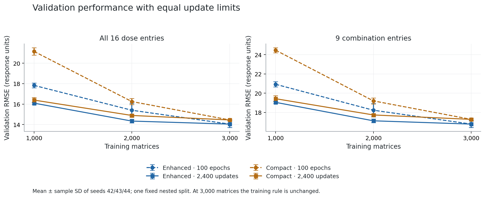
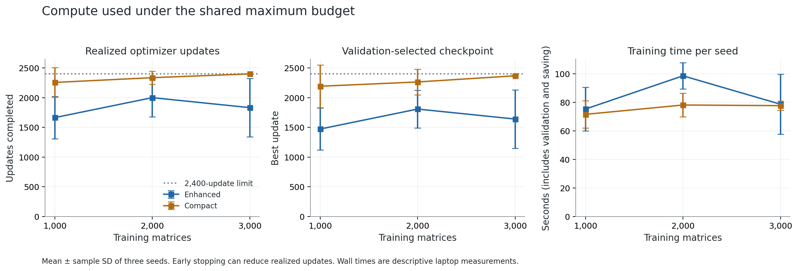
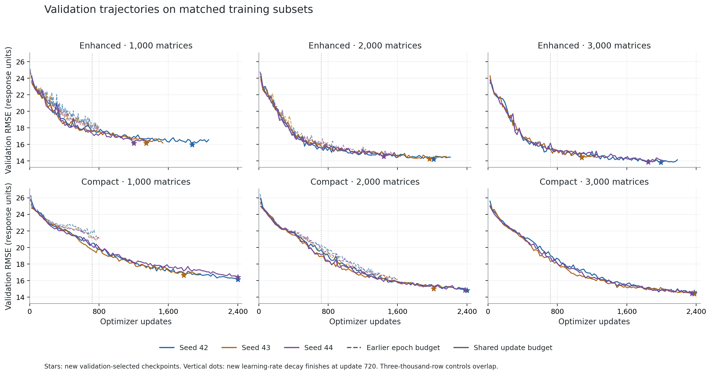

# Equal optimizer-update budget: validation results

All **18 new fits** are complete: two fixed models × 1,000/2,000/3,000 matrices × seeds 42/43/44. The shared maximum is 2,400 optimizer updates; 37,464 updates were actually used, with 24.0 minutes of summed training time.

The validation accuracy winner is **Enhanced with 3,000 matrices**, RMSE **14.048 ± 0.329**. The best compact configuration uses **3,000 matrices**, RMSE **14.454 ± 0.064**. Every ± value is sample SD across three seeds on one fixed split, not a confidence interval.

## Matched accuracy comparison

Negative changes favor the update-budget run. The earlier runs had a maximum of 100 epochs, corresponding to 800/1,600/2,400 updates at the three sizes. Combination entries exclude the zero-dose row and column.

| Model | Training matrices | Earlier all-16 RMSE | New all-16 RMSE | Paired change | Earlier combination-9 RMSE | New combination-9 RMSE |
|---|---:|---:|---:|---:|---:|---:|
| Enhanced | 1,000 | 17.831 ± 0.241 | 16.095 ± 0.105 | -1.736 ± 0.338 | 20.923 ± 0.275 | 19.046 ± 0.109 |
| Compact | 1,000 | 21.152 ± 0.366 | 16.396 ± 0.247 | -4.757 ± 0.613 | 24.468 ± 0.262 | 19.424 ± 0.315 |
| Enhanced | 2,000 | 15.402 ± 0.660 | 14.343 ± 0.178 | -1.059 ± 0.827 | 18.226 ± 0.693 | 17.126 ± 0.185 |
| Compact | 2,000 | 16.252 ± 0.312 | 14.892 ± 0.101 | -1.360 ± 0.370 | 19.196 ± 0.313 | 17.735 ± 0.115 |
| Enhanced | 3,000 | 14.048 ± 0.329 | 14.048 ± 0.329 | +0.000 ± 0.000 | 16.784 ± 0.350 | 16.784 ± 0.350 |
| Compact | 3,000 | 14.454 ± 0.064 | 14.454 ± 0.064 | +0.000 ± 0.000 | 17.277 ± 0.067 | 17.277 ± 0.067 |

## Compute and stopping

| Model | Matrices | Parameters | Mean updates completed | Mean best update | Fits at the limit | Mean training seconds | Peak allocated CUDA MiB |
|---|---:|---:|---:|---:|---:|---:|---:|
| Enhanced | 1,000 | 40,944,401 | 1664 | 1472 | 0/3 | 75.4 | 791.5 |
| Compact | 1,000 | 3,499,409 | 2256 | 2192 | 2/3 | 71.6 | 127.5 |
| Enhanced | 2,000 | 40,944,401 | 2000 | 1808 | 0/3 | 98.6 | 791.5 |
| Compact | 2,000 | 3,499,409 | 2336 | 2264 | 2/3 | 78.2 | 127.5 |
| Enhanced | 3,000 | 40,944,401 | 1832 | 1640 | 0/3 | 78.7 | 791.5 |
| Compact | 3,000 | 3,499,409 | 2400 | 2368 | 3/3 | 77.7 | 127.5 |

7 of 18 fits reached 2,400 updates; 11 stopped earlier after eight failed validation checks. Stopping is based on all-16 validation error. Combination-only error is reported at that same checkpoint. The maximum epochs equivalent are 300/150/100; a 2,000-matrix run can stop halfway through an epoch.

Times include optimizer work, validation and checkpoint saving. The earlier times and these times were measured in different sessions, with some different diagnostic overhead and uncontrolled laptop thermal/load conditions. Use update counts and parameter counts for the controlled compute comparison; treat wall times as descriptive.

## What this resolves

For enhanced, the 1,000-matrix validation RMSE changes by -1.736 (-9.7%) under the update-based rule. Its remaining mean gap to the 3,000-matrix setting is +2.047 response units.

At 2,000 matrices, enhanced validation RMSE changes by -1.059 (-6.9%). Using one third fewer training matrices leaves a mean gap of +0.294 response units to its 3,000-matrix setting.

For compact, the 1,000-matrix validation RMSE changes by -4.757 (-22.5%) under the update-based rule. Its remaining mean gap to the 3,000-matrix setting is +1.941 response units.

At 2,000 matrices, compact validation RMSE changes by -1.360 (-8.4%). Using one third fewer training matrices leaves a mean gap of +0.438 response units to its 3,000-matrix setting.

At 1,000 and 2,000 matrices, the intervention combines a larger update limit, learning-rate decay ending at update 720, validation every 24 updates and patience measured as 192 updates. It estimates the effect of that combined timing rule; it does not isolate extra training duration from each timing change. Both architecture packages and augmentation remain fixed.

All six 3,000-matrix controls exactly reproduced their earlier saved predictions on CUDA, and training/validation/lr trajectories match to 1e-10 absolute tolerance. Their unchanged results are a reproducibility check of the new runner, not six additional independent experimental replications.

## Validation and provenance

The protocol was frozen before training (SHA-256 `7f8384f7daac2295a44c025f08e5b7fd852d6a2701cde0c62fe7d567349fb034`). It fixes source hashes, all 18 earlier checkpoint/prediction/history identities, exact nested training row IDs, seeds, model definitions, optimizer schedule, endpoints, ranking rule and stopping rule. Every one of the six configuration groups is complete; the ranking averages all three seeds.

Independent verification recomputed all-16 and combination-9 RMSE, Pearson and Spearman for all 36 earlier/new validation prediction files. Validation source IDs, observed values and available dose arrays match the prepared data. The dose audit confirms that the interior nine entries have positive doses on both axes. Batch arithmetic independently confirms actual update counts, examples seen, scheduler boundaries and strict patience.

All 18 new checkpoints were rebuilt from their saved variant/configuration and reproduced their stored validation predictions exactly on CUDA; checkpoint seed/data/protocol identities and training rows were checked.

One wording caveat in the frozen protocol: 'do not load ... holdout' is stricter than the shared data-loader behavior. The runner reads the existing 5,000-row prepared container, which includes unused original test rows, to construct its train/validation loaders. Only split 1 enters training and split 2 enters checkpoint selection. No original test response is evaluated or used for any decision; neither original test predictions nor the newer inspected holdout dataset/predictions are used here. No new held-out evaluation was performed.

## Scope and next decision

These are validation results from repeated development on a single fixed, pair-disjoint split. The three seeds describe initialization/training variation, not sampling uncertainty across new splits. The subsets use one shared nested ordering; correlated pairs can share drugs and cell lines. The study does not establish a minimum sufficient dataset size, generalization accuracy, parameter identifiability or an isolated activation/initialization effect.

Carry **enhanced / 3,000 matrices** forward as the validation accuracy choice, and **compact / 3,000 matrices** as the resource candidate. Before any further tuning, reserve a new evaluation set and freeze the final comparison. The already inspected holdouts cannot provide an untouched final confirmation after adaptive development. Independent-source data would provide a stronger next check.

## Inspectable artifacts

- `../protocol.json`, `../protocol.sha256`: frozen design and source/data identities.
- `../selection.json`, `../completed.json`: all validation-selected checkpoints and completion accounting.
- `validation_per_seed.csv`, `validation_summary.csv`: earlier/new errors and compute for all seeds.
- `paired_changes_per_seed.csv`, `paired_changes_summary.csv`: matched-seed differences.
- `verification.json`: audit/reload results and analysis source fingerprints.
- `test_results.txt`: saved full correctness-suite output for this experiment, when present.
- `figures/`: PNG and SVG figures; per-fit histories/predictions/checkpoints are under `../training/`.
